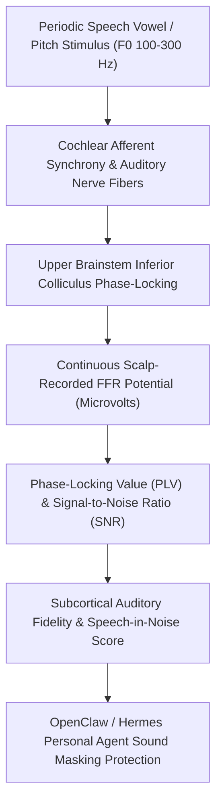

# Acoustic Frequency Following Response (FFR) Skill

[](LICENSE)
[](https://www.python.org/)
[](requirements.txt)
[](mcp_server.py)
[](SKILL.md)

Zero-dependency sovereign personal agent skill for non-invasive evaluation of Auditory Brainstem Frequency Following Response (FFR) Phase-Locking Value (PLV), SNR, and subcortical temporal envelope encoding fidelity.



## Features
- **Deterministic Math**: Pure Python standard library implementation with zero external dependencies.
- **Auditory Electrophysiology Standards**: Implements validated equations for brainstem FFR amplitude, inter-trial phase-locking value (PLV), and stimulus cross-correlation.
- **Hidden Hearing Loss & Synaptopathy Shield**: Sensitive detection of auditory brainstem temporal jitter prior to pure-tone threshold loss.
- **Model Context Protocol (MCP)**: Native JSON-RPC tool integration for LLMs and autonomous agents.

## Quickstart

```python
from client import AcousticFrequencyFollowingResponseClient

client = AcousticFrequencyFollowingResponseClient()
result = client.evaluate_ffr(
    stimulus_fundamental_freq_hz=150.0,
    ffr_amplitude_uv=0.42,
    phase_locking_value=0.79,
    signal_to_noise_ratio_db=9.4
)
print("Phase-Locking Value:", result["phase_locking_value"])
print("Precision Score:", result["subcortical_precision_score"])
print("Classification:", result["classification"])
```

## License
Apache-2.0
